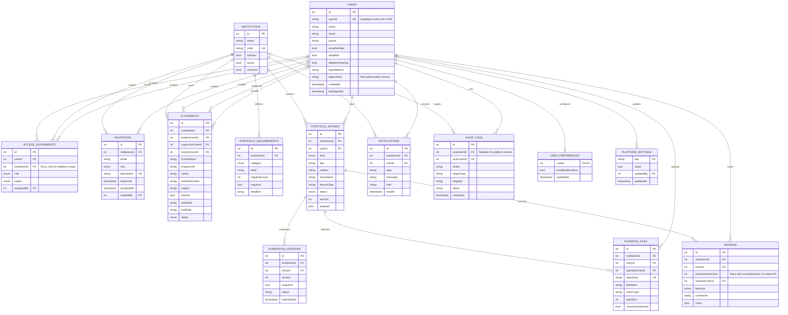

# Teachfolio entity relationship diagram

The diagram reflects the PostgreSQL definitions in `drizzle/schema.ts`. `users` is the application's profile/link table; credentials live in Supabase Auth. `access_assignments` is the source of application roles.

## Relationship and lifecycle notes

- A user may have multiple role assignments, but active institution access is accepted only when all active assignments are for one institution. A platform admin's active scope is platform-only and uses a null institution ID.
- An invitation's raw token is returned for delivery only when email delivery is unavailable; the database stores its SHA-256 hash. Redemption links the matching signed-in email to an active assignment and records an audit event.
- A portfolio entry is the editable current record. Every submission creates a `submission_versions` snapshot. A review identifies the corresponding `entryId` and `submissionVersion`; the schema does not declare a compound foreign key for that pair.
- Evidence metadata points to a private object key, not a public URL. The server authorizes the user before streaming the file from private storage.
- Account deletion retains the user row as an anonymized tombstone so academic and audit references remain intact.
- Platform-wide settings are key/value rows. Current keys include `invitation_expiry_days` and `max_evidence_mib`.
